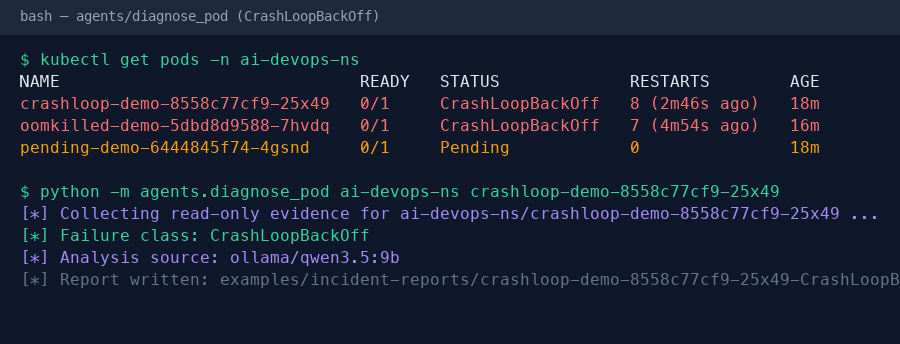
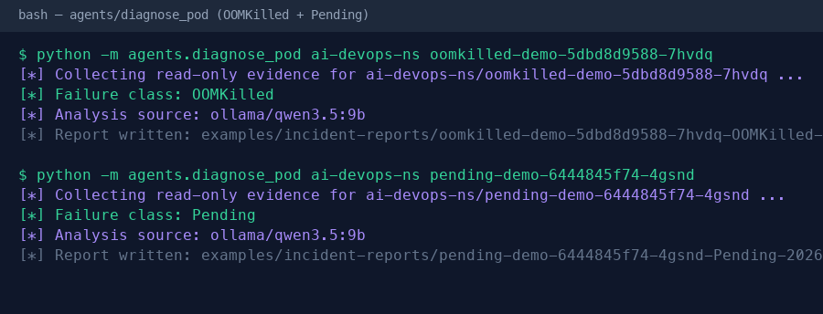
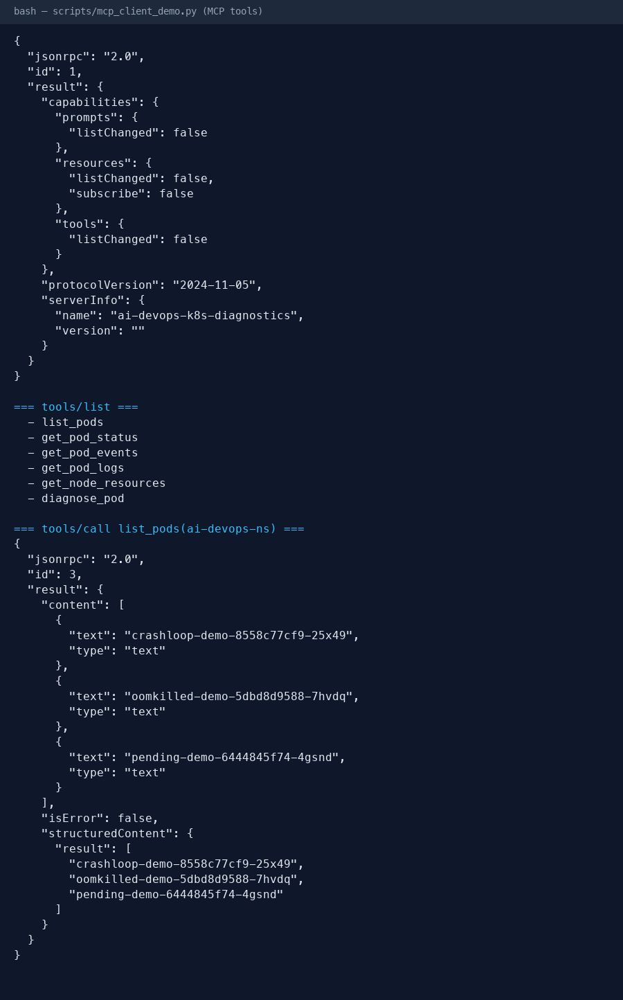
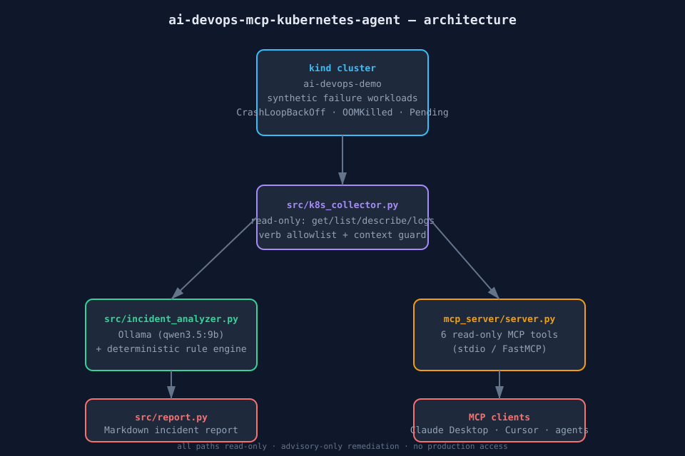

# ai-devops-mcp-kubernetes-agent

An AI-assisted Kubernetes troubleshooting workflow that demonstrates **Agentic DevOps** end-to-end: a read-only **MCP (Model Context Protocol) server** that exposes Kubernetes diagnostic tools, a **diagnostic agent** that collects evidence from a real cluster, and an **LLM (Ollama) analyzer** that turns raw evidence into a plain-English incident report with suspected root cause and recommended remediation.

> **Advisory by design.** Every Kubernetes action is read-only. The agent never patches, deletes, applies, or scales anything. It diagnoses a *local* `kind` cluster using synthetic failure fixtures — it never touches production.

---

## What this demonstrates

| Capability | How it is shown |
|---|---|
| Kubernetes diagnosis | Real `kubectl` evidence collection against a local `kind` cluster |
| CrashLoopBackOff | `fixtures/crashloop.yaml` — container exits non-zero on start |
| OOMKilled | `fixtures/oomkilled.yaml` — container exceeds a tiny memory limit |
| Pending pods | `fixtures/pending.yaml` — requests a node selector no node satisfies |
| MCP server | `mcp_server/server.py` — read-only diagnostic tools over stdio |
| AI analysis | `incident_analyzer.py` — Ollama (`qwen3.5:9b`) explains root cause |
| Deterministic fallback | Rule-based analyzer works fully offline, no LLM required |
| Safety controls | Read-only API surface, allowlisted verbs, isolated kubeconfig |

## Architecture

```
┌──────────────┐   kubectl (read-only)   ┌──────────────────────┐
│   kind       │ ───────────────────────▶ │  k8s_collector.py    │
│  (local)     │   pods/events/logs/     │  evidence collector  │
└──────────────┘   deploy/nodes          └──────────┬───────────┘
                                                    │ evidence dict
                       ┌────────────────────────────┴──────────┐
                       ▼                                       ▼
            ┌─────────────────────┐                ┌─────────────────────┐
            │  incident_analyzer  │                │  MCP server          │
            │  (Ollama qwen3.5:9b)│                │  server.py (tools)   │
            │  + rule fallback    │                │  list_pods, logs,    │
            └─────────┬───────────┘                │  events, nodes ...   │
                      │                            └─────────────────────┘
                      ▼                                       │
            ┌─────────────────────┐                           │
            │  report.py           │◀─────────────────────────┘ (clients call
            │  incident report     │                            tools directly)
            │  (plain English)     │
            └─────────────────────┘
```

## Screenshots

| Screenshot | Description |
|---|---|
|  | `agents/diagnose_pod` + Ollama classifying a CrashLoopBackOff pod |
|  | Ollama classifying OOMKilled and Pending pods |
|  | `mcp_client_demo.py` exercising the read-only MCP tools |

## Sample incident reports

- [`sample-report-CrashLoopBackOff.md`](examples/incident-reports/sample-report-CrashLoopBackOff.md)
- [`sample-report-OOMKilled.md`](examples/incident-reports/sample-report-OOMKilled.md)
- [`sample-report-Pending.md`](examples/incident-reports/sample-report-Pending.md)

## Architecture



See [docs/ARCHITECTURE.md](docs/ARCHITECTURE.md) for the full design and safety model.

---

## Quick start

### Prerequisites

- Docker Desktop (running) or Colima
- [`kind`](https://kind.sigs.k8s.io/) (`brew install kind`)
- `kubectl` (`brew install kubectl`)
- Python 3.10+ and [`uv`](https://docs.astral.sh/uv/) (or `pip`)
- [Ollama](https://ollama.com) with a model pulled (optional — see [LLM](#llm-analysis))

### 1. Bootstrap the local cluster

```bash
./scripts/cluster_up.sh          # creates kind cluster + loads synthetic fixtures
```

This creates a kind cluster named `ai-devops-demo` and applies three failing
workloads to trigger CrashLoopBackOff, OOMKilled, and Pending states.

### 2. Install dependencies

```bash
uv venv && source .venv/bin/activate
uv pip install -r requirements.txt
```

### 3. Run a diagnosis

```bash
export KUBECONFIG="$(kind get kubeconfig --name ai-devops-demo)"
python -m agents.diagnose_pod ai-devops-ns crashloop-demo
```

This collects evidence and produces a Markdown incident report under
`examples/incident-reports/`.

### 4. Try the MCP server

```bash
python mcp_server/server.py         # lists available tools on startup
# or drive it with the MCP client:
python scripts/mcp_client_demo.py
```

### 5. Tear down

```bash
./scripts/cluster_down.sh
```

---

## LLM analysis

Analysis uses **Ollama** by default. The model is resolved in this order:

1. `AI_DEVOPS_OLLAMA_MODEL` environment variable, if set.
2. The first *locally installed* (non-cloud) model from an allowlist, otherwise `qwen3.5:9b`.

```bash
ollama pull qwen3.5:9b            # local model (no paid API)
```

If Ollama is unreachable or no model is installed, the analyzer falls back to a
**deterministic rule-based engine** that inspects container exit codes, pod
status/conditions, events, resource limits, and node allocatable capacity to
produce the same report structure — so the project remains fully runnable
offline.

---

## Safety controls

- **Read-only Kubernetes surface.** The collector and MCP tools only issue
  `get`, `list`, and `describe` (and `logs`). A denylist blocks `apply`, `patch`,
  `delete`, `scale`, `exec`, `create`, `edit`, `replace`, and any verb carrying a
  mutation.
- **Isolated kubeconfig.** All commands run against the dedicated
  `KUBECONFIG` for the `kind` cluster. A startup guard aborts if the active
  context is not the expected local cluster.
- **No production access.** There is no code path, credential, or configuration
  that references any AWS account, production EKS context, private IP, or
  internal hostname.
- **Advisory-only remediation.** Reports contain *suggested* fixes in plain text.
  The system performs no automated writes.

---

## Repository layout

```
src/                 # evidence collector + analyzer + report writer
mcp_server/          # read-only MCP server (stdio)
agents/              # CLI entrypoint: diagnose_pod.py
fixtures/            # synthetic failure workloads
tests/               # pytest suite (mocked + live)
scripts/             # cluster lifecycle + secret scan + MCP demo
examples/            # generated incident reports
docs/                # architecture + design notes
.github/workflows/   # CI (lint + unit tests)
```

## Testing

```bash
pytest -q                          # unit tests (no cluster required)
./scripts/secret_scan.sh           # gitleaks + grep sweep for secrets
```

## License

MIT — see [LICENSE](LICENSE).
